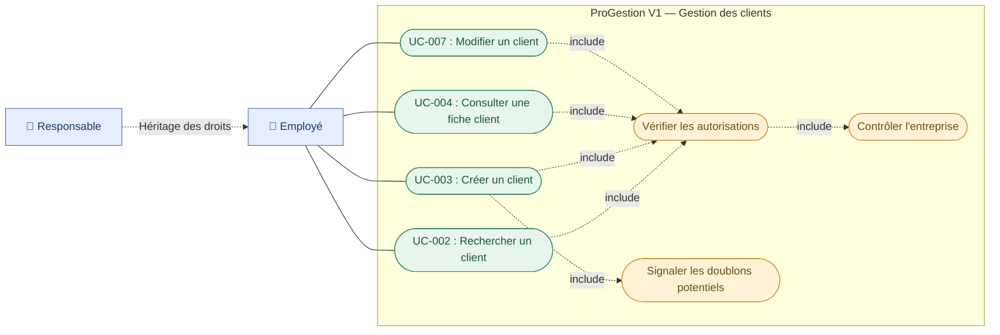

# ProGestion SaaS — Diagramme des cas d'utilisation : Gestion des clients

**Version :** 1.0  
**Date :** 29/10/2026  
**Statut :** VALIDÉ  
**Epic :** EPIC-01 — Gestion des clients

## Objectif

Représenter les interactions des utilisateurs avec les fonctionnalités de gestion des clients.

## Diagramme Mermaid

## Description des cas d'utilisation

| ID     | Cas d'utilisation          | User Story |
| ------ | -------------------------- | ---------- |
| UC-002 | Rechercher un client       | US-001     |
| UC-003 | Créer un client            | US-002     |
| UC-004 | Consulter une fiche client | US-007     |
| UC-007 | Modifier un client         | US-003     |

## Règles métier

1. Le nom du client est obligatoire.
2. Au moins un moyen de contact est obligatoire.
3. Les doublons potentiels sont signalés.
4. Les identifiants clients ne sont pas modifiables.
5. Les données des entreprises sont isolées.
6. La suppression définitive n'est pas disponible en V1.

## Validation

**Statut : VALIDÉ — Version 1.0**
