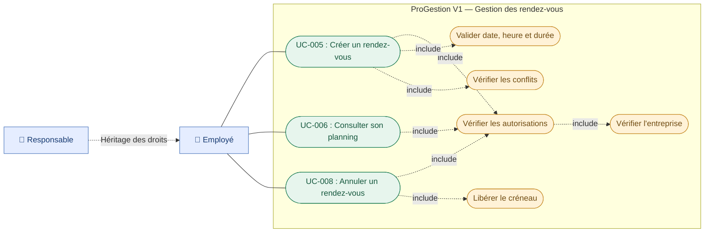

# ProGestion SaaS — Diagramme des cas d'utilisation : Gestion des rendez-vous

**Version :** 1.0  
**Date :** 29/10/2026  
**Statut :** VALIDÉ  
**Epic :** EPIC-02 — Gestion des rendez-vous

## Objectif

Présenter les fonctionnalités de gestion des rendez-vous accessibles aux employés et responsables.

## Diagramme Mermaid

## Description des cas d'utilisation

| ID     | Cas d'utilisation      | User Story |
| ------ | ---------------------- | ---------- |
| UC-005 | Créer un rendez-vous   | US-004     |
| UC-006 | Consulter son planning | US-005     |
| UC-008 | Annuler un rendez-vous | US-006     |

## Règles métier

1. Chaque rendez-vous est associé à un client existant.
2. Chaque rendez-vous est affecté à un employé actif.
3. Le client et l'employé appartiennent à la même entreprise.
4. Les rendez-vous sont autorisés du lundi au samedi.
5. Les horaires sont compris entre 08 h 00 et 19 h 00.
6. Les durées autorisées sont de 30, 60, 90 ou 120 minutes.
7. Deux rendez-vous confirmés du même employé ne peuvent pas se chevaucher.
8. Un rendez-vous annulé libère le créneau.
9. Les rendez-vous annulés restent enregistrés.

## Validation

**Statut : VALIDÉ — Version 1.0**
